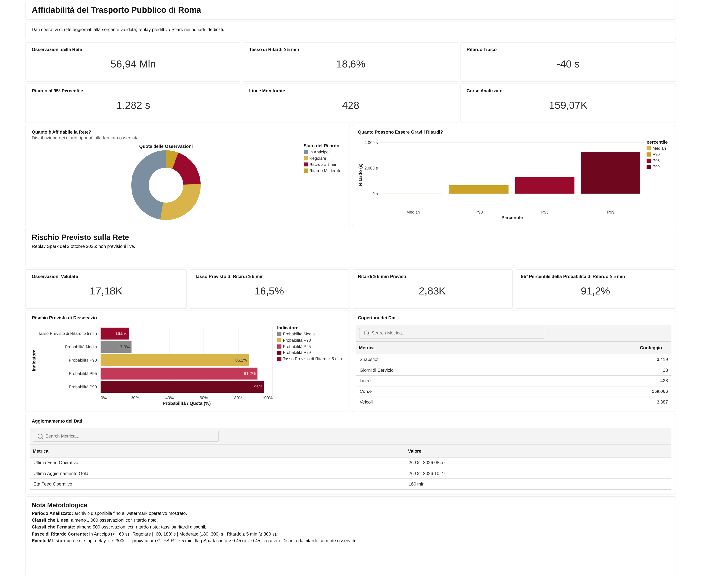
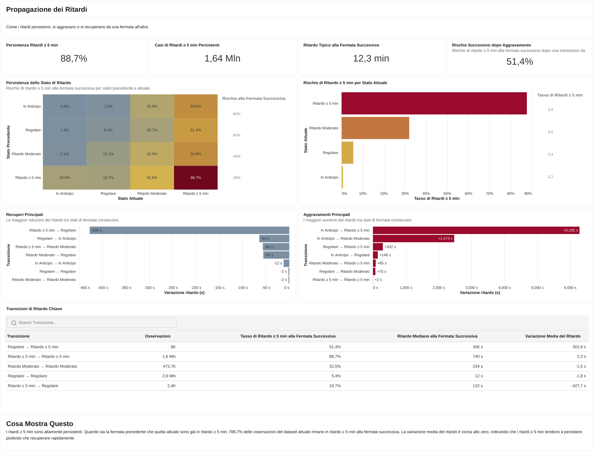
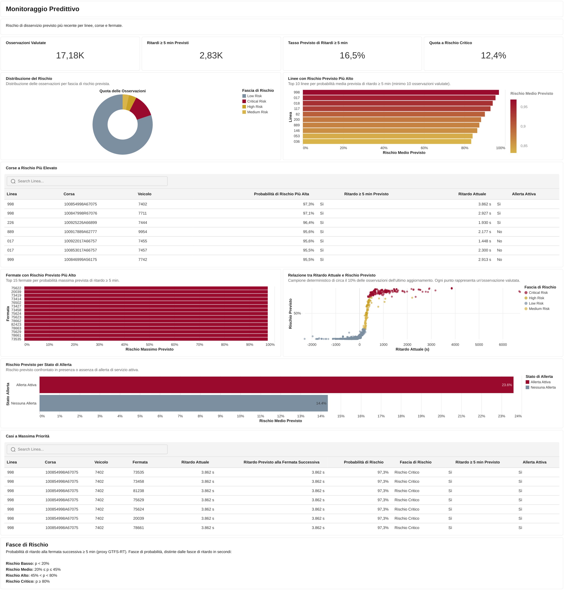
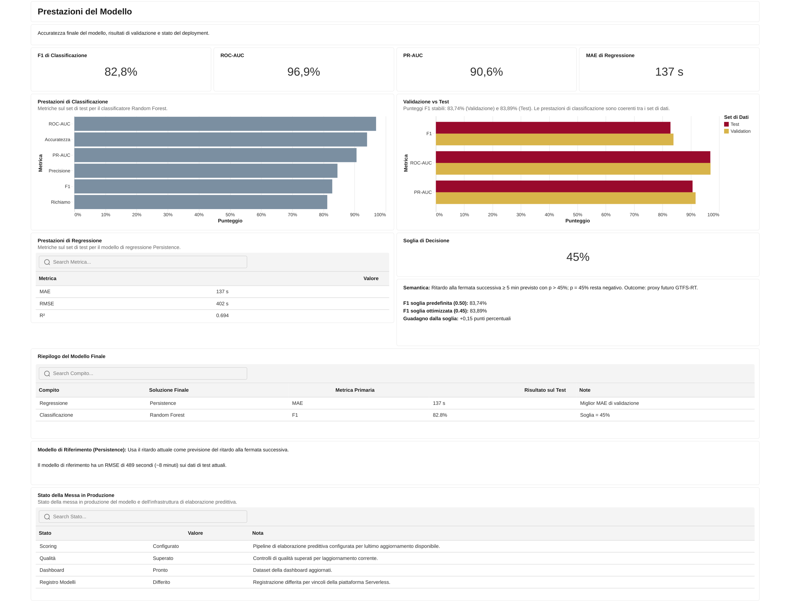

# Rome Public Transport Reliability & Delay Prediction

**Stato runtime al 26 ottobre 2026:** Silver osservazioni v10, enrichment v10 (56,941,882 righe) e input scoring v5 (26,327 righe) allineati al feed **1793001463 / 2026-10-26T08:57:43+01:00**. Gold operativo validato, refresh **2026-10-26T09:27:31.249044+00:00**. Sono dati del batch validato, non una promessa di latenza live. Prediction e metriche Spark restano evidenze storiche. Job downstream separato predisposto, **PAUSED**, con proposta iniziale ogni 2 ore basata sul benchmark di circa 45 minuti; ingestion 05 invariata ogni 10 minuti. [Evidenze, limiti e orchestrazione](docs/DOWNSTREAM_RUNTIME_ROLLOUT.md).


Un lakehouse Databricks per i feed del trasporto pubblico di Roma, con analisi storiche dell'affidabilità, ricerca predittiva e dashboard di Business Intelligence. Il nuovo target operativo separa i dati Databricks dal futuro runtime ML FastAPI/Python/scikit-learn.

**Stack:** Databricks · Apache Spark / PySpark · Delta Lake · Unity Catalog · MLflow · Databricks SQL · Databricks AI/BI Dashboards · Python · SQL

**Stato al 26 ottobre 2026:** ingestion Bronze pianificata e operativa; Silver, enrichment, input scoring e Gold operativo validati sul batch del 26 ottobre. Il nuovo Job downstream è predisposto in pausa, con proposta iniziale ogni 2 ore; non si dichiara ancora aggiornamento downstream automatico. Persistence e Random Forest restano risultati storici di riferimento; FastAPI/sklearn è il futuro runtime ML operativo. [Evidenze runtime e lag](docs/DOWNSTREAM_RUNTIME_ROLLOUT.md), [decisione](docs/ARCHITECTURE_DECISIONS.md), [contratti](docs/OPERATIONAL_ML_HANDOFF.md), [roadmap](docs/ROADMAP.md).

## Anteprima Dashboard

**Export aggiornati il 26 ottobre 2026:** PDF completo e quattro screenshot sono estratti dalla dashboard pubblicata in tema chiaro. Overview, Reliability e Propagation descrivono i dati operativi fino al feed **26 ottobre 08:57 Europe/Rome**; Predictive, Model Performance e i riquadri predittivi di Overview restano evidenze Spark storiche del 2 ottobre. Non si dichiara inference ML live. Il PDF include la correzione della label Propagation di [PR #9](https://github.com/matteocavo/rome-public-transport-reliability/pull/9), già pubblicata nel workspace e ancora da integrare nel JSON di main. [Provenienza e verifiche](dashboard/databricks/README.md).

<p align="center">
  
</p>

## Obiettivo del progetto

Quanto ritardo è prevedibile alla fermata successiva? Qual è la probabilità di un ritardo ≥ 5 min? Quali linee, fermate e fasce orarie presentano i maggiori problemi di affidabilità?

Il progetto affronta queste domande integrando Data Engineering, Feature Engineering temporale, confronto con baseline, valutazione ML, analisi SQL e BI. È un progetto di portfolio orientato alle esigenze degli operatori della mobilità locale; non implica un'adozione operativa da parte di Roma Capitale.

La [metodologia PACE](docs/PACE.md) documenta le motivazioni progettuali, le decisioni implementate, i risultati e gli scostamenti dal piano iniziale.

## Architettura

```text
Feed ufficiali GTFS Static + GTFS-Realtime
  → Databricks Bronze → Silver → feature osservabili / etichette offline
  → contratti versionati via Databricks SQL
  → futuro FastAPI / sklearn: training, valutazione, artifact, inference
  → futura prediction history → Gold / serving → API → React
Databricks orchestration: ingestion / Silver / enrichment / feature preparation
n8n: futura readiness / chiamate backend / retry / alert cross-system
Google AI Studio: futura generazione e iterazione UX/UI React
Dashboard AI/BI / Power BI separato: analisi curate, con date esplicite
```

Le tabelle Delta sono governate tramite Unity Catalog. La dashboard interroga esclusivamente Gold. Il diagramma descrive il target: ingestion è pianificata; la catena downstream è validata manualmente e il Job separato è in pausa. Backend, n8n e frontend restano futuri. Il tracciamento MLflow e i notebook Spark restano **ML storico / sperimentale**, conservati come ricerca e riferimento. Spark PipelineModel non è il runtime operativo target: smoke bloccato dalla whitelist Spark Connect e classic compute non disponibile nel workspace Free. [ADR-001](docs/ARCHITECTURE_DECISIONS.md).

## Fonti dei dati

I feed ufficiali di Roma Servizi per la Mobilità forniscono linee, corse, fermate, orari, calendari e tracciati GTFS Static, oltre a Trip Updates, Vehicle Positions e Service Alerts GTFS-Realtime. Un Job Databricks acquisisce i feed **ogni 10 minuti** e conserva le snapshot in un archivio storico Delta. `rome_transport.bronze.ingestion_runs` registra stato ed errori; le esecuzioni successive proseguono dopo errori transitori dei feed.

**PR2 — rollout runtime verificato il 25 ottobre 2026:** applicate le nove colonne audit additive e sincronizzati i notebook 05, 07 e 99 dal merge `ae7f9ef`. La run manuale controllata è terminata SUCCESS con tre SOURCE SUCCESS e BATCH RUNNING/SUCCESS; schemi e payload Bronze preesistenti sono preservati e i duplicati storici non sono cresciuti. Trigger ogni 10 minuti ripristinato con configurazione Job invariata; anche la prima run pianificata post-rollout è terminata SUCCESS. Il notebook 07 è distribuito ma non eseguito; empty-feed, DIFFERENTIAL, retry della stessa snapshot e failure restano validati offline, senza fault injection in produzione. Dettagli e impatto del refresh alert in [INGESTION_AUDIT.md](docs/INGESTION_AUDIT.md).

I file GTFS Static di riferimento rimangono localmente in `data/reference/gtfs_static/` e sono ignorati da Git per le loro dimensioni. Durante l'esecuzione, l'ingestion statica utilizza percorsi dei volumi Unity Catalog in Databricks.

## Pipeline e sequenza dei notebook

| Notebook | Responsabilità implementata |
| --- | --- |
| 01–03 | Configurazione dell'ambiente ed elaborazione GTFS Static nei livelli Bronze/Silver |
| 04–05 | Acquisizione realtime, raccolta pianificata e audit dell'ingestion |
| 06–07 | Silver realtime, associazione causale delle posizioni e arricchimento con orari e avvisi |
| 08 | Feature temporali, delle fermate precedenti, dei veicoli, spaziali, degli avvisi e dello storico |
| 09 | Etichettatura futura della fermata successiva, provenienza e filtro di qualità delle etichette |
| 10 | Confronto tra baseline ed esperimenti di regressione/classificazione |
| 11 | Tuning su validation, selezione finale e valutazione TEST a decisioni congelate |
| 12 | Tentativo storico di registrazione e replay batch; percorso di riferimento |
| 12 common / 12a / 12b | Implementazione Spark di riferimento per persistenza/inference; gate OFF, percorso operativo sostituito |
| 13 | Analisi Gold, controlli di qualità e metadati di aggiornamento |
| 99 | Controlli sullo stato della pipeline realtime |

I principali passaggi analitici sono `rome_transport.silver.realtime_enriched_observations`, `rome_transport.features.next_stop_delay_features` e `rome_transport.features.next_stop_delay_labeled`.

## Qualità dei dati e prevenzione del leakage

- Le posizioni dei veicoli sono associate con un join **causal backward as-of**, su veicolo e corsa: sono ammesse solo posizioni precedenti o coincidenti con il timestamp del Trip Update, con anzianità massima di **180 secondi**.
- Lag e finestre mobili utilizzano le fermate precedenti nella stessa snapshot della corsa; gli aggregati storici utilizzano timestamp del feed strettamente precedenti.
- `target_realized_next_stop_delay_seconds` utilizza la prima snapshot successiva valida della stessa corsa, data di servizio e fermata target identificata da ID/sequenza, entro **30 minuti**. Il ritardo in arrivo ha priorità; quello in partenza è usato come alternativa quando disponibile.
- Gli esiti futuri servono esclusivamente come etichette. `provisional_next_stop_delay_seconds`, presente nella stessa snapshot, rimane riservato all'audit; target e provenienza delle etichette sono esclusi dagli input del modello e dagli output predittivi operativi.
- La valutazione utilizza gruppi cronologici di timestamp distinti, con ripartizione indicativa **70/15/15** tra train / validation / test. Il preprocessing viene stimato sul train; le etichette la cui disponibilità supera il confine con la partizione successiva vengono escluse dalla partizione precedente.
- Modelli, iperparametri e soglie decisionali sono selezionati su validation e congelati prima della valutazione TEST finale. Lo sbilanciamento delle classi viene valutato tramite precision, recall, F1 e PR-AUC della classe positiva, insieme all'accuracy.

### Filtro di qualità delle etichette realizzate

Il dataset esteso analizzato il 2 ottobre conteneva **10.007.020 righe etichettate prima del filtro finale di qualità**. I conteggi diagnostici erano cumulativi:

| Ritardo realizzato in valore assoluto | Righe |
| --- | ---: |
| > 1 ora | 104.719 |
| > 2 ore | 39.008 |
| > 4 ore | 33.850 |
| > 12 ore | 31.317 |

Le **31.317 etichette oltre ±12 ore rappresentano circa lo 0.31%** delle 10.007.020 etichette realizzate. Di queste, **31.249 ricadevano nelle ore del feed comprese tra le 21:00 e le 03:59**: circa il **99.8% del solo gruppo >12 ore**. Appena il **36.3%** di tale gruppo superava già ±12 ore nel target GTFS-RT provvisorio.

Questa concentrazione supporta l'interpretazione di artefatti legati al passaggio della mezzanotte, alla gestione del giorno di servizio GTFS e alla temporizzazione dei feed, anziché di ritardi operativi plausibili alla fermata successiva. La regola di inclusione nel training è:

```python
MAX_PLAUSIBLE_ABS_REALIZED_DELAY_SECONDS = 43200
```

```sql
ABS(target_realized_next_stop_delay_seconds) <= 43200
```

Si tratta di una **regola di qualità fondata su evidenze**, non di rimozione arbitraria degli outlier, winsorization, clipping o filtraggio guidato dal modello. I ritardi oltre 1, 2 o 4 ore rimangono ammissibili entro ±12 ore. Le etichette escluse non vengono alterate o corrette artificialmente; i target provvisori restano invariati.

Il filtro preserva ritardi severi ma plausibili ed evita che artefatti di circa 24–29 ore distorcano MAE, RMSE, media del target e training della regressione. Soglia ed evidenze rendono la decisione riproducibile e verificabile: non implicano che tutti i dati notturni siano invalidi, né che ±12 ore sia una soglia statisticamente ottimale o universalmente valida per GTFS. Il filtro è applicato: **10.007.020 - 31.317 = 9.975.703 osservazioni etichettate finali**.

## Dataset etichettato finale

`rome_transport.features.next_stop_delay_labeled` contiene **9.975.703 osservazioni dopo il filtro di qualità**.

| Copertura | Valore finale |
| --- | ---: |
| Snapshot realtime | 964 |
| Date di servizio | 8 |
| Linee | 412 |
| Corse | 82.936 |
| Veicoli | 2.157 |

I conteggi si riferiscono alle osservazioni: snapshot ripetute possono generare più righe per la stessa corsa e fermata. La copertura riguarda i feed etichettati, non l'intero servizio programmato né un'affidabilità ponderata per passeggeri.

## Risultati storici di Machine Learning

### Regressione: Persistence

È stato mantenuto l'approccio più solido nella validazione: prevedere `current_arrival_delay_seconds`, con **−71 secondi**, mediana del train, come valore sostitutivo quando il dato manca. I modelli di regressione più complessi non hanno prodotto un miglioramento sufficiente; non se ne afferma la superiorità rispetto a Persistence.

| Metrica TEST finale | Valore |
| --- | ---: |
| MAE | 136.9818 secondi |
| RMSE | 401.8525 secondi |
| R² | 0.6940 |
| WAPE | 0.3293 |

### Classificazione storica: RandomForestClassifier

Configurazione congelata: `numTrees=100`, `maxDepth=10`, `minInstancesPerNode=5`, `featureSubsetStrategy="sqrt"`, `maxBins=32`, `seed=42`.

```python
predicted_major_delay_flag = major_delay_probability > 0.45
```

Il confronto è **strettamente maggiore**: la soglia è stata fissata prima della valutazione TEST finale.

| Metrica TEST finale | Valore |
| --- | ---: |
| Accuracy | 0.9401 |
| Precision | 0.8450 |
| Recall | 0.8123 |
| F1 | 0.8283 |
| ROC-AUC | 0.9690 |
| PR-AUC | 0.9063 |

**Metriche TEST storiche di riferimento:** risultati Spark congelati, non prestazioni del futuro modello sklearn. `historical_model_threshold = 0.45`; la soglia del nuovo modello operativo dovrà essere validata nella nuova valutazione. Nessuna conversione automatica Spark RF → sklearn RF o equivalenza degli iperparametri è assunta.

### Contratto semantico: Ritardo ≥ 5 min

L'evento canonico `next_stop_delay_ge_300s` indica il **proxy GTFS-Realtime del ritardo alla fermata successiva >=300 secondi**. Il display è **Ritardo ≥ 5 min**, oppure **Ritardo alla fermata successiva ≥ 5 min**. `target_realized_major_delay_flag` vale 1 quando `target_realized_next_stop_delay_seconds >= 300`; `major_delay_probability` è la probabilità di questo evento. Il proxy è una futura osservazione del feed, non un arrivo certificato.

| Fascia di ritardo | Intervallo in secondi |
| --- | --- |
| In Anticipo (`early`) | `< -60` |
| Regolare (`on_time`) | `[-60, 180)` |
| Moderato (`moderate_delay`) | `[180, 300)` |
| Ritardo ≥ 5 min (`major_delay`) | `>= 300` |

Le fasce di probabilità storiche sono: Basso `p < 0.20`, Medio `0.20 <= p <= 0.45`, Alto `0.45 < p < 0.80`, Critico `p >= 0.80`. Il flag Spark storico usa **strettamente `p > 0.45`**: a `p = 0.45` resta negativo. Target ≥300 secondi invariato; soglia e calibrazione del futuro modello saranno rivalidate.

`current_status` è lo stato GTFS del veicolo, non una fascia di severità del ritardo. `is_currently_delayed_flag` indica `current_arrival_delay_seconds > 60`: è una feature distinta dal target ML. Persistence mantiene il delay corrente, con fallback **−71 secondi** per NULL/NaN. Colonne tecniche, formule e risultati restano invariati.

**PR3 - rollout runtime validato il 25 ottobre 2026:** helper e notebook 08/scoring distribuiti dal merge `c343f1e`. Parità Spark old/new PASS su scope deterministico; staging `rome_transport.features.next_stop_delay_scoring` creata in Delta v0 con 24.797 righe e contratto invariato (42 numeriche + 5 categoriche). Nessun training o scoring modello eseguito. La sorgente è Silver v8, ultima snapshot del 2 ottobre: staging dell’ultimo input disponibile, non feed corrente fresco. Overwrite controllato, gate di default ancora disabilitato, nessuno storico delle prediction. [Evidenze runtime, valori mancanti e limiti](docs/CURRENT_SCORING.md).

**PR4 - implementazione Spark di riferimento:** `12a_fit_persist_final_classifier`, `12b_score_current_input` e helper conservano il disegno di persistenza completa e inference separata, con gate OFF. Il rollout ha verificato MLflow tracking, ma lo smoke Spark ML è fallito prima del fit; la richiesta di compute Dedicated è stata rifiutata. Nessun artifact operativo PR4 persistito o ricaricato. Il nuovo percorso operativo è esterno. [Stato e storia tecnica](docs/MODEL_SERVING.md).

## Batch scoring e registrazione

`rome_transport.ml.next_stop_delay_predictions` contiene l'ultima snapshot valutata: **17.177 righe**, **2.831** previsioni con flag positivo e quota di ritardo ≥ 5 min previsto **0.16481**, applicando il confronto stretto `probability > 0.45`.

| Sintesi della probabilità di ritardo ≥ 5 min | Valore |
| --- | ---: |
| Media | 0.17923 |
| P90 | 0.86189 |
| P95 | 0.91219 |
| P99 | 0.95041 |

Il batch verificato è `historical_latest_snapshot_replay`: scoring della snapshot del 2 ottobre 2026 dal labeled dataset v8, eseguito il 3 ottobre con sovrapposizione ai dati di refit. Le label sono escluse dagli input del modello, ma la popolazione deriva dal dataset etichettato; non è scoring corrente indipendente dalle label né un'API live. Un singolo batch non dimostra una tendenza predittiva né nuove prestazioni su dati mai osservati.

Tracciamento MLflow, selezione e replay storico sono completati. Lo stato storico `DEFERRED_SERVERLESS_LIMITATION` resta conservato: nessuna registrazione Spark in produzione è riuscita. Il target FastAPI/sklearn possiederà i propri artifact e non dipenderà da UC model registration. Il replay esistente non viene modificato.

## Livello analitico Gold

Il rilascio Gold operativo ha superato i controlli. I nuovi campi `ops_` descrivono i ritardi riportati alla fermata osservata, con tassi sui valori disponibili. Le colonne storiche senza prefisso, inclusi `major_delay_count/rate`, mantengono il proxy futuro ≥300 secondi e i valori di riferimento. Non sono metriche direttamente confrontabili: popolazione, esito e denominatore differiscono. [Definizioni e conteggi](docs/DOWNSTREAM_RUNTIME_ROLLOUT.md).

| Tabella in `rome_transport.gold` | Finalità e granularità |
| --- | --- |
| `executive_overview` | KPI di rete e sintesi delle ultime previsioni; una riga |
| `route_reliability` | Affidabilità per linea |
| `stop_reliability` | Affidabilità nel contesto della fermata corrente |
| `temporal_reliability` | Data di servizio, giorno della settimana e ora del feed |
| `delay_propagation` | Combinazioni delle fasce di ritardo corrente e precedente |
| `predictive_operations` | Granularità delle osservazioni di scoring, senza etichette future |
| `model_performance` | Risultati congelati per task, dataset e metrica |
| `analytics_refresh_metadata` | Versioni delle sorgenti e audit dell'aggiornamento |

Nel rilascio storico le classifiche richiedevano almeno **1.000 osservazioni** per linea (**354 linee ammissibili**) e **500** per fermata (**5.172 fermate ammissibili**). Il percorso operativo ricalcola i ranking con almeno 1.000 ritardi noti per linea e 500 per fermata, senza riusare i conteggi storici.

## Risultati analitici storici del proxy futuro

Gli aggregati storici coprono **9.975.703 osservazioni**: ritardo medio **24.7172 secondi**, mediana **−71 secondi**, P90 **644 secondi**, P95 **1.198 secondi** e P99 **3.102 secondi**. Il conteggio riportato dei ritardi ≥ 5 min è **1.878.569**, con quota **0.18831**, per il proxy alla fermata successiva ≥300 secondi.

Le quote per fascia oraria sono: Notte **0.06551**, Mattina **0.15457**, Fascia centrale **0.18944**, Punta serale **0.20327** e Sera **0.25224**. Alle ore 20 la quota raggiunge **0.30286**; nei giorni feriali e nel fine settimana è rispettivamente **0.18574** e **0.19748**.

Quando la fermata corrente è già classificata in ritardo ≥ 5 min, la frequenza di ritardo ≥ 5 min alla successiva è **0.88714**, su circa **1.64 milioni di osservazioni**, con ritardo mediano alla fermata successiva di **740 secondi**. Nella transizione da fermata precedente Regolare a fermata corrente in Ritardo ≥ 5 min, la frequenza è **0.51389**. Sono associazioni descrittive di propagazione secondo le fasce registrate, non effetti causali universali. Le fasce corrente/precedente usano gli stessi confini −60/180/300 secondi.

## Dashboard

**Rome Public Transport Reliability**, con titolo italiano **Affidabilità del Trasporto Pubblico di Roma**, è implementata e validata in Databricks, con dataset SQL provenienti esclusivamente da Gold. Le cinque pagine sono:

1. Panoramica Esecutiva
2. Affidabilità della Rete
3. Propagazione dei Ritardi
4. Monitoraggio Predittivo
5. Prestazioni del Modello

### Anteprime delle analisi

La Panoramica Esecutiva è mostrata in apertura; qui seguono tre ulteriori pagine della dashboard.

<p align="center">
  
  <br>
  <em>Quote delle transizioni tra stime di ritardo nella stessa snapshot</em>
</p>

<p align="center">
  
  <br>
  <em>Replay predittivo Spark storico del 2 ottobre 2026; non inference live</em>
</p>

<p align="center">
  
  <br>
  <em>Metriche TEST storiche Spark/Persistence; FastAPI/sklearn resta il target futuro</em>
</p>

L’interfaccia italiana è una scelta intenzionale, coerente con il contesto operativo della mobilità pubblica romana. Le fasce di rischio del JSON corrispondono al campo Gold `risk_band`: Basso p<0.20, Medio 0.20<=p<=0.45, Alto 0.45<p<0.80, Critico p>=0.80. Sono fasce di probabilità dell’evento ≥5 min, distinte dalla severità in secondi e dalla decisione binaria.

La dashboard è pubblicata **all'interno di Databricks e richiede autenticazione**: non è accessibile anonimamente né costituisce una dashboard pubblica per recruiter. È un limite di distribuzione del portfolio. Il repository contiene l'[export JSON della dashboard](dashboard/databricks/dashboard/Affidabilita_Trasporto_Pubblico_Roma.lvdash.json) e il [PDF completo della dashboard](dashboard/databricks/pdf/Affidabilita_Trasporto_Pubblico_Roma.pdf), consultabile senza accedere a Databricks. Il PDF comprende le cinque pagine nell'ordine elencato sopra ed è un'esportazione statica, non una dashboard live. È pianificato un [livello di presentazione Power BI](dashboard/powerbi/README.md) separato.

## Struttura del repository

```text
README.md
.gitignore
contracts/
  operational_ml.json
  operational_ml.py
dashboard/
  databricks/
    README.md  [provenienza e verifica degli export pubblicati]
    dashboard/
      Affidabilita_Trasporto_Pubblico_Roma.lvdash.json
    pdf/
      Affidabilita_Trasporto_Pubblico_Roma.pdf
    screenshots/
      overview.png
      propagation.png
      predictive.png
      model-performance.png
  powerbi/
    README.md
    report/
    screenshots/
data/
  reference/
    gtfs_static/  [file sorgente locali ignorati da Git]
docs/
  PACE.md
  ARCHITECTURE_DECISIONS.md
  OPERATIONAL_ML_HANDOFF.md
  ROADMAP.md
  CURRENT_SCORING.md
  MODEL_SERVING.md
  INGESTION_AUDIT.md
notebooks/
  01_environment_setup.sql
  02_gtfs_static_bronze_ingestion.py
  03_gtfs_static_silver.py
  04_gtfs_realtime_ingestion.py
  05_gtfs_realtime_pipeline.py
  06_gtfs_realtime_silver.py
  07_gtfs_realtime_enrichment.py
  08_feature_engineering.py
  08_common_feature_preparation.py
  08_current_scoring_dataset.py
  09_target_labeling.py
  10_model_training.py
  11_model_tuning_and_selection.py
  12_model_registration_and_scoring.py
  12_common_persisted_classifier.py
  12a_fit_persist_final_classifier.py
  12b_score_current_input.py
  13_gold_analytics.py
  99_realtime_pipeline_health_check.sql
tests/
```

Git non versiona le directory vuote. Le impostazioni locali del workspace dell'editor sono ignorate e non compaiono nella struttura destinata alla pubblicazione.

## Limiti

Le osservazioni future GTFS-Realtime sono proxy operativi e possono ancora essere previsioni riviste. Posizioni mancanti o obsolete, variazioni degli orari e anomalie al cambio del giorno di servizio limitano l'interpretazione. Il filtro ±12 ore affronta artefatti diagnosticati: non è una soglia GTFS universale e non rende automaticamente invalidi i dati notturni.

Otto date di servizio non dimostrano generalizzazione sul lungo periodo o sull'intera rete cittadina. I timestamp del feed non provano da soli la disponibilità in ingestion; il replay non è una nuova valutazione TEST. La dashboard richiede autenticazione. PDF e screenshot sono export statici del 26 ottobre, con watermark operativo e ambito storico del modello espliciti; non provano aggiornamento continuo o deployment ML operativo. Free Edition ha quote e nessuno SLA.

## Sviluppi futuri

Seguire la [roadmap operativa](docs/ROADMAP.md): attivazione del Job downstream predisposto, futuro repository `rome-mobility-intelligence`, FastAPI/sklearn con nuova valutazione/persistenza, inference, prediction history, n8n, serving/API, React/Google AI Studio, AI insight e Power BI separato. Questo repository mantiene ingestion, lakehouse, contratti, analytics, Gold e metadati di freshness. Nessun repository app è creato da questa PR.

## Stato del progetto

**Implementati e validati storicamente:** Bronze/Silver, associazione causale delle posizioni, Feature Engineering, etichettatura futura e filtro di qualità, esperimenti MLflow, selezione su validation, TEST congelato, replay batch, Gold, SQL e dashboard AI/BI. Ingestion pianificata operativa; il percorso downstream operativo è ora validato manualmente; il suo Job resta in pausa. PDF e quattro screenshot riallineati alla dashboard pubblicata del 26 ottobre, con ambiti operativo e modello storico distinti.

**Percorso sostituito:** deployment Spark ML, conservato come implementazione storica/di riferimento; runtime operativo futuro FastAPI/sklearn.

**Da completare:** attivazione controllata del Job downstream dopo verifica delle quote, backend operativo e presentazione app; mantenimento degli export allineati ai successivi rilasci della dashboard. Non si dichiara un'API live, un modello operativo già distribuito o adozione cittadina.
